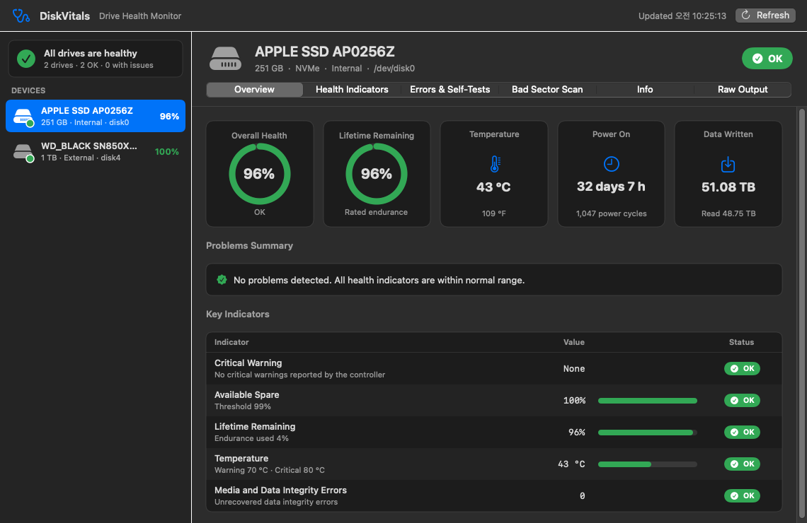
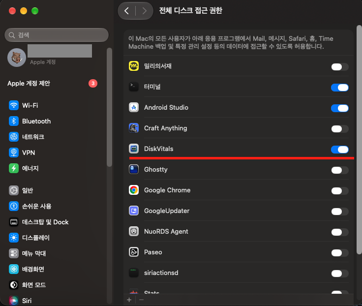

# DiskVitals

A native macOS drive health monitor written in Swift. It reads S.M.A.R.T. / NVMe health data through [smartmontools](https://www.smartmontools.org/) and shows it in a SwiftUI interface.



## Features

- Lists physical drives (internal and external) with a health badge
- Overview: overall health, lifetime remaining, temperature, power-on time, data read/written
- Tabs: Health Indicators, S.M.A.R.T. Attributes (ATA), Errors & Self-Tests, Info, Raw output
- Read-only Bad Sector (surface) Scan, run as a privileged worker after an administrator prompt

## Requirements

- macOS 13 or later
- smartmontools: `brew install smartmontools`

## Build

```sh
make        # universal DiskVitals.app + DiskVitals.dmg
make run    # build and run the release binary
```

The app is ad-hoc signed, so on another Mac the first launch needs right-click → Open.

## Notes

- The health score is an estimate: min(lifetime left, available spare), capped when the drive reports a warning or failure.
- When the drive does not report temperature thresholds, 70 °C / 80 °C are used.

## macOS Setting

Give DiskVitals Full Disk Access so it can read drive data:

1. Open **System Settings → Privacy & Security → Full Disk Access**.
2. Turn on **DiskVitals** (use **+** to add it from Applications if it is not listed).
3. Quit and reopen DiskVitals.


